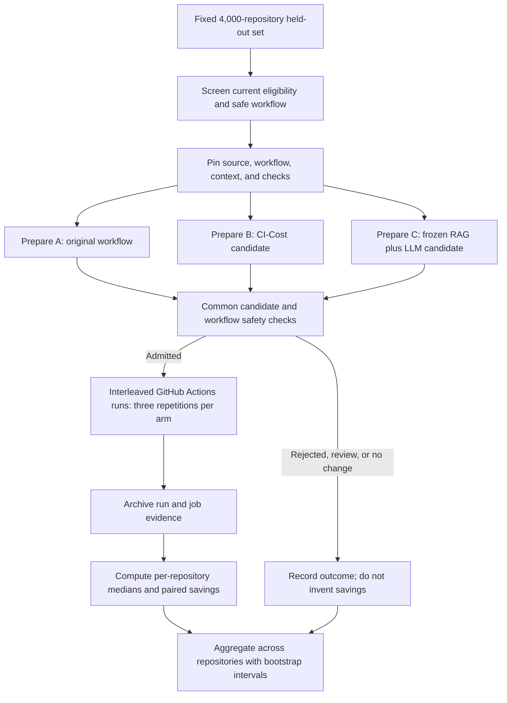

# Evaluation methodology

## Aim and comparison arms

The evaluation tests whether optimized CI workflows preserve required behavior while reducing active CI time and runner use. Each repository is evaluated from the same pinned source and workflow snapshot:

- **A — Original:** unchanged workflow; establishes the baseline.
- **B — CI-Cost:** workflow candidate from the pinned, source-corrected CI-Cost implementation.
- **C — RAG + LLM:** candidate from retrieval against the frozen BGE-M3 knowledge base and a fixed OpenRouter model.

There is no LLM-only arm. Results for C measure the combined RAG-plus-LLM method and cannot isolate RAG’s contribution from the LLM.

## Evaluation set and controls

The held-out set was created from a 5,000-repository GitHub Actions metadata sample published by [Zenodo](https://zenodo.org/records/20340547). The selection process excluded 500 repositories associated with pattern development or prior experiment records, then sampled 4,000 of the remaining 4,500 uniformly without replacement using seed `20261031`. The 4,000 assignments are fixed and divided into four groups of 1,000. The source metadata is a historical snapshot; it is not treated as proof that a repository is currently eligible.

Before execution, screen each assigned repository for a safe, active build or test workflow and current GitHub accessibility. Pin its source commit, workflow, relevant dependency context, and declared check contract. Keep the same snapshot across A/B/C, use isolated branches on research-owned forks, and leave upstream repositories unchanged. Do not tune prompts, policies, or selection rules from held-out outcomes.

## Candidate preparation and safety admission

1. Prepare A from the original pinned workflow.
2. Generate B with the pinned CI-Cost release and its reviewed source correction.
3. Generate C using the frozen RAG corpus, the same pinned BGE-M3 embedding revision, retrieved evidence, repository context, and the fixed LLM configuration. Preserve retrieved record identifiers and candidate provenance.
4. Apply the same conservative safety gate to B and C. Check YAML structure and Actions syntax, workflow triggers and permissions, job and matrix preservation, build/test commands, dependency inputs, and allowed change scope. The current automatic admission policy is limited to narrow, additive dependency-download caching. Other changes require review and are not dispatched automatically.

Record each result as admitted, rejected, review-required, inconclusive, no-change, or failed. An optimizer’s no-change decision is retained in the denominator; it is not presented as an applied optimization or a measured saving. Execute optimized candidates only after they pass admission. Preserve original workflow behavior and required checks as correctness constraints.

## GitHub Actions runs and timing

Run admitted A/B/C arms on GitHub Actions in the candidate fork. Perform three measured repetitions per admitted arm and interleave arm order to reduce time-of-day and runner-load bias. Preserve each run’s identity, pinned commit, arm, repetition order, workflow and candidate hashes, conclusion, job timestamps, required-check result, and failure reason. A run that never starts a job is platform-inconclusive, not a zero-duration or failed-workload timing.

The primary timing metric, **active workflow time**, is the union of intervals when at least one target job is running. Overlapping jobs count once; initial queue delay and periods with no active job are excluded. Also report:

- **Initial queue delay:** workflow creation to first actual job start.
- **Workflow makespan:** first job start to last job finish, including idle gaps.
- **Inter-job idle time:** makespan less active workflow time.
- **Summed job runtime:** total duration across executed jobs; overlapping jobs count separately as a runner-use proxy.

Do not include local candidate generation, retrieval, model latency, or queue time in active CI time. Do not call summed job runtime billed cost without billing evidence.

## Analysis and reporting

For each repository, first take the median of valid repetitions in each arm. Calculate elapsed-time savings for B and C against A, and for C against B:

`Savings (%) = 100 × (baseline median − candidate median) / baseline median`

Repeat the calculation with summed job runtime for runner-use savings. Aggregate paired repository-level effects using the median and interquartile range, with 95% confidence intervals from 1,000 repository-bootstrap resamples when there are enough paired repositories. The repository/workflow is the analysis unit; repeated runs of one repository are not independent observations.

Report candidate admission and required-check pass rates, no-change and rejection rates, failures, regressions, incomplete and platform-inconclusive runs, and the paired repository count. Keep the full 4,000-assignment denominator visible. Calculate savings only from comparable successful executions with passing safety and required-check outcomes; never fill missing measurements with estimates. Report retrieval relevance and generation latency as supplementary measures, separate from CI time.

## Reproducibility and current status

Keep assignment hashes, source commits, workflow and candidate hashes, CI-Cost version, RAG corpus digest, embedding revision, generator model and prompt version, run IDs, and raw job timing evidence with the results. The frozen RAG corpus is verified before C; it is not retrained or modified during the held-out evaluation.

The repository contains the evaluation dataset, fixed assignments, candidate-generation components, validation and execution code, and reporting logic. Live verification of the RAG retrieval path, shared safety gate, and candidate-fork execution remains pending; therefore this methodology does not claim completed held-out results or CI time savings.

## Evaluation flow

