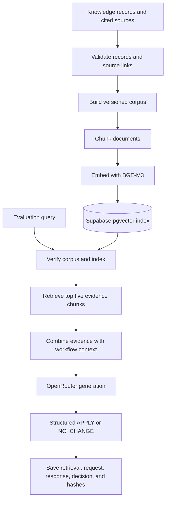

# RAG methodology

## Purpose

The pipeline prepares a versioned knowledge base and retrieves relevant evidence for workflow recommendations. It does **not** fine-tune or update the language model’s weights.

## RAG training and retrieval pipeline

Here, “training” means preparing and indexing retrieval knowledge. It does not update the generator model’s weights.

## Training pipeline

1. **Validate knowledge — `scripts/validate_knowledge.py`.** Check pattern-record structure, source IDs and locators, and (with `--check-artifacts`) source hashes, page bounds, and example diffs.
2. **Build corpus — `scripts/build_rag_dataset.py`.** Turn the pattern registry and eligible, pattern-linked evidence into JSONL documents. Each pattern document retains its source, method, prerequisites, limitations, and example material. The script writes JSONL, structured JSON, and a manifest with counts and hashes. The current corpus has 74 retrieval-eligible documents, including 25 pattern documents.
3. **Embed and index — `scripts/embed_rag_supabase.py`.** Use BGE-M3 to create normalized 1,024-dimensional embeddings. Split long documents into 1,024-token chunks with 128-token overlap, then store chunks, metadata, and source/model hashes in Supabase pgvector. The resolved model revision is recorded.
4. **Verify and retrieve — `evaluation/rag_retriever.py`.** Before retrieval, check that the local corpus hash, indexed document set, chunk counts, and embedding revision match. Embed the query with the same BGE-M3 revision and request the top five matching chunks.
5. **Generate — `evaluation/optimizers/rag_llm.py`.** Combine retrieved evidence with the selected workflow and bounded repository context, then send it to the configured OpenRouter model. Require a structured `APPLY` or `NO_CHANGE` response, a rationale, and valid retrieved evidence IDs. Preserve the request, response, retrieval set, decision, and artifact hashes.

## Reproducibility

The current corpus digest is `94c3ae909d96246be4286c6743ea76a0418c5ddbfcdec2ae6d402eb46e7d0f68`. The model, corpus digest, retrieval depth, prompt version, generator model, and response metadata are recorded with the generated candidate. Main artifacts are `research-data/rag/rag_dataset.jsonl`, `research-data/rag/rag_dataset_manifest.json`, and each candidate’s `retrieval.json`, `llm_request.json`, `llm_response.json`, and `candidate.json`.
