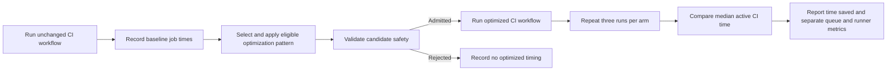
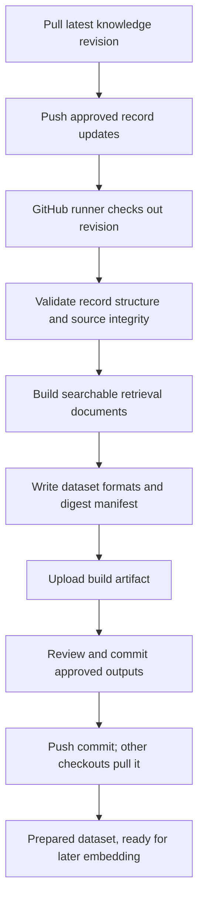

# RAG dataset preparation methodology

## Scope

This document covers the work up to creation of the retrieval dataset. It ends before text embedding or vector indexing. “Training” refers to preparing searchable, source-linked knowledge; it does not fine-tune a language model.

## Work completed

The literature extraction contains 25 CI optimization pattern records drawn from five papers. Each record captures the optimization mechanism, method, applicability conditions, limitations, reported findings and metrics, and a source locator. The records are currently marked as drafts in the knowledge registry.

The data preparation process validates record structure, unique identifiers, source metadata, and evidence locators. Integrity checking also verifies source hashes, page bounds, and registry counts. The dataset builder turns the records into stable, searchable documents, preserves their citations, and writes a line-based retrieval dataset, a structured dataset, and a manifest with document counts and SHA-256 digests. The current corpus digest is `94c3ae909d96246be4286c6743ea76a0418c5ddbfcdec2ae6d402eb46e7d0f68`.

## CI time optimization coverage

The knowledge base covers mechanisms that affect CI elapsed time, runner time, queue delay, or time to failure feedback:

- **Reduce repeated work:** cache dependency downloads; cache Bazel build results; evaluate dependency-cache overhead; reuse validated build environments; share cached build dependencies; reuse work across compatible configurations.
- **Avoid unnecessary work:** cancel remaining matrix jobs after failure; cancel superseded runs; skip explicitly dispensable workflow runs; filter triggers by changed paths; pause repeatedly failing scheduled workflows; suppress schedules during repository inactivity; select tests using change dependencies; select builds using change or outcome predictions; skip steps using traced dependencies; remove genuinely unused outputs; evaluate skipping unused-dependency updates.
- **Improve feedback and bound execution:** run previously failing jobs first; prioritize tests for early failure feedback; prioritize queued builds; tune Bazel build parallelism; bound jobs with a custom timeout; derive timeout candidates from successful history; predict duration to guide investigation; repair evidenced configuration smells.

These are research mechanisms and reported findings, not locally measured CI time savings. The dataset-preparation process has no recorded elapsed-time measurements, so it makes no runtime or speedup claims.

## CI time measurement loop

For an optimization evaluation, first run the unchanged workflow on GitHub Actions and record its job timings as the baseline. Generate a candidate that applies an eligible pattern, validate it for workflow safety, then run the candidate workflow on the same prepared source and compare its timings with the baseline. The evaluation uses three repeated runs per admitted arm and interleaves run order to reduce ordering effects. The arms are the original workflow, the CI-Cost candidate, and the RAG-plus-LLM candidate.

The primary comparison uses active workflow time: the union of intervals when at least one CI job is actually running. Calculate time saved as the baseline median minus the candidate median; calculate percentage saved as that difference divided by the baseline median. Record queue delay, end-to-end makespan, gaps between jobs, and total summed job runtime separately. Do not count queue delay or local model/generation time as CI execution, and do not call a proposed or rejected change a measured saving. A failed or unadmitted candidate does not receive an invented timing result.

## Source papers

1. [Resource Usage and Optimization Opportunities in Workflows of GitHub Actions (2024)](https://software-lab.org/publications/icse2024_workflows.pdf)
2. [What helped, and what did not? An Evaluation of the Strategies to Improve Continuous Integration (2021)](https://arxiv.org/pdf/2102.06666)
3. [Does Using Bazel Help Speed Up Continuous Integration Builds? (2024)](https://arxiv.org/pdf/2405.00796)
4. [Accelerating Continuous Integration by Caching Environments and Inferring Dependencies (2022)](https://rebels.cs.uwaterloo.ca/papers/tse2020_gallaba.pdf)
5. [Build Optimization: A Systematic Literature Review (2025)](https://arxiv.org/pdf/2501.11940)

The extracted records retain section, table, or page locators for the claims they use. The systematic review is secondary evidence; its findings remain identified as such.

## GitHub preparation and handoff

The intended workflow is to pull the latest branch, push reviewed knowledge updates, have a GitHub Actions runner check out that revision, validate the records, build the dataset, and upload the generated data and manifest as a workflow artifact. Review the artifact before committing and pushing it. Other checkouts pull the approved commit. The repository does not currently contain a dedicated Actions workflow for this build, so GitHub execution is a documented process rather than an already configured automation.

## Flow chart

