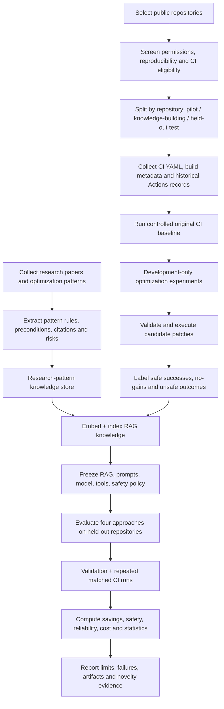
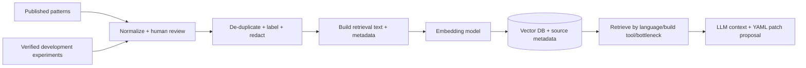

# CloudHeal Research Methodology: Full Workflow, Data Preparation, Knowledge Building, and Evaluation

**Working title:** Repository-Aware CI Workflow Optimization Using LLMs and Research-Grounded RAG: An Experimental Comparison  
**Target platform:** GitHub Actions  
**Research question:** Can an LLM using targeted repository evidence and research-grounded RAG generate safer, more effective GitHub Actions performance refactorings than the original workflow, `ci-cost`, and an LLM without RAG?  
**Document role:** Step-by-step protocol for a reproducible experimental study; planned activities are **not** completed results.

## 0. Scope, assumptions, and key choices

| Decision | Selected approach | Rationale |
|---|---|---|
| Main task | Optimize **existing, working** GitHub Actions CI workflows | Do not conflate optimization with repairing initially failing CI |
| Repository understanding | **Targeted** extraction (CI YAML, package/build files, directory structure, run history); inspect additional files only on demand | Lower cost than sending complete codebases to the LLM |
| Knowledge source | Published optimization research **plus** verified successes and failures from development experiments | Test the value of outcome-grounded RAG |
| Model training | **No LLM weight training in version 1** | Building an embeddings-backed RAG index is knowledge preparation, not LLM fine-tuning |
| Four main approaches | M0 original, M1 `ci-cost`, M2 LLM-only, M3 LLM + RAG | Separates actual savings, existing automation, model contribution, and retrieval contribution |
| Primary outcome | **Safe workflow-level elapsed-time reduction**, with runner consumption reported separately | Faster because required CI work was skipped is not an acceptable gain |
| Experimental execution | Isolated forks or owned test repositories; matched source revisions; repeated real GitHub Actions runs | Supports actual rather than purely estimated savings |
| Starting size | 3–5 pilot repos, 5–10 **development/knowledge** repos, 20–30 **held-out evaluation** repos (target, not a statistically proven minimum) | Feasible staged execution; finalize sample size after pilot variability/power analysis |
| First version | One eligible workflow per repository for the primary paired analysis | Reduces correlation and complexity; additional workflows are secondary analyses |

> **Reconciliation of earlier CloudHeal plans:** The earlier “behavior-preserving CI refactoring” draft discussed LoRA/fine-tuning; the later LLM + RAG pilot specified learning by storing verified examples without updating model weights. **This protocol adopts the later, simpler RAG-only research plan for version 1.** Fine-tuning is future work or an optional independently evaluated extension.

## 1. Objectives and hypotheses

1. **Identify CI optimization patterns:** Document techniques, preconditions, limits, and safety risks from existing research.
2. **Develop repository-aware LLM + RAG optimization:** Extract relevant repository context and use retrieved, evidenced patterns to propose CI YAML changes.
3. **Evaluate effectiveness:** Compare original CI, `ci-cost`, LLM-only, and LLM + RAG using real workflow execution measurements.
4. **Assess safety and reliability:** Verify required CI behavior, tests, checks, and failure detection are not weakened by time-reduction changes.

**Pre-registered hypotheses (test rather than assume):**
- **H1:** M3 yields greater *safe* elapsed-time reduction than M2 on held-out repositories.
- **H2:** M3 yields greater *safe* elapsed-time reduction than M1 (`ci-cost`).
- **H3:** RAG using verified outcome examples produces fewer harmful/non-beneficial modifications than LLM-only.
- **H4:** The safety guard rejects unsafe candidates, including changes that reduce apparent time by omitting required checks.

**Null results are valid research results.** Report where RAG does not help, increases cost, or correctly decides `NO_CHANGE`.

## 2. End-to-end research and experiment flow



**Important ordering:** evaluation repositories must not contribute verified examples to the frozen RAG used to evaluate those repositories.

## 3. Phase A — Collect and prepare source data

### A1. Select repositories

**Candidate sources:** published repository lists (such as the ICSE 2024 GitHub Actions data artifact), curated open-source projects, and GitHub repository search. A past list of candidate projects is a **screening shortlist**, not a verified runnable set.

**Eligibility checklist (record Yes/No and a reason):**
1. Repository accessible and legally appropriate for research; use a fork/controlled copy.
2. Has an existing GitHub Actions CI workflow with build/lint/test checks.
3. A reproducible, pinned source commit can be selected.
4. No unavailable production secrets, required production deployments, signing, releases, billing, or destructive side effects.
5. Forked workflows can run with permissions and branch conditions understood; self-hosted runners are excluded in v1.
6. Baseline succeeds under an established environment; dependency/toolchain availability confirmed.
7. Workflow has a realistic optimization opportunity **or** belongs to a separately labeled “already efficient/no change” stratum.
8. Size and expected runtime fit available GitHub Actions quotas and research budget.
9. Project language, CI jobs, matrices, and expected runtime recorded for stratification.
10. External dependencies and paid integrations are excluded or safely mocked **identically across all treatments**.

**Sampling:** stratify by language/ecosystem (e.g., JavaScript/TypeScript, Python, Java, Go), matrix size, baseline duration, cache use, and optimization opportunity. Do not cherry-pick only repositories on which M3 succeeds. Count and report excluded repositories and reasons.

### A2. Lock the experimental snapshot

For each eligible repository, capture:
- `owner/repo`, original URL, license, fork URL, default branch, selected **40-character commit SHA**, UTC extraction date.
- Selected workflow path and SHA of the workflow file.
- Git tree / file-list checksum, dependency lockfile hashes, runtime/toolchain versions if available.
- Restrictions: fork guards, `pull_request` behavior, required services, missing secrets, reusable workflow dependencies.
- Runner OS / label and all required job checks and matrix combinations.

**Fairness invariant:** For M0–M3 on one project, the **non-workflow application file tree must be identical**. Only authorized workflow/configuration optimizations may differ. Record the patch and verify this invariant mechanically. Use the same dependency lockfile and pinned application revision. If an optimization legitimately changes auxiliary CI scripts, label and evaluate it as an expanded treatment rather than silently mixing it into the main workflow-YAML-only study.

### A3. Extract CI-relevant repository context (GitHub API, not full-codebase ingestion)

| Information | Retrieval | Output fields |
|---|---|---|
| Workflow YAML | Contents API at pinned ref, `.github/workflows/*.yml|*.yaml` | Paths, triggers, jobs, `needs`, matrices, runners, steps, caching, timeout, permissions |
| Directory layout | Git Trees API at pinned ref | Relevant paths and top-level components; detect truncated tree responses |
| Build and dependency files | Contents API at pinned ref | Manifests/lockfile names, build/test scripts, package manager, tool versions, workspaces |
| Historical execution | Actions workflow runs API filtered by workflow/ref as possible | Run ID, `head_sha`, event, status, conclusion, start/end, actor/trigger |
| Historical job/step timing | Workflow jobs API, paginated | Job ID, name, runner label, step timings, job timings, conclusions |
| Optional diagnostics | Authorized job logs | Redacted failure or slow-step evidence; never forward secrets to the model |

**Relevant manifest examples:** `package.json`, lockfiles, `pyproject.toml`, `requirements*.txt`, `tox.ini`, `pom.xml`, `build.gradle`, `go.mod`, `Cargo.toml`, `Makefile`, `Dockerfile`, and selected CI scripts. Read a file only if it helps explain a known CI job. Filter binaries, vendored dependencies, build outputs, large source trees, secrets, private environment files, and irrelevant logs.

**Extractor algorithm:**
1. Query repository metadata and pin SHA.
2. Enumerate workflow files and select the target CI workflow.
3. Parse YAML **without losing GitHub Actions expression semantics**; preserve original raw YAML for patching.
4. Identify referenced commands and manifest paths; fetch only those files.
5. Fetch recent comparable runs/jobs and compute robust timings; distinguish historical evidence from experimental evidence.
6. Produce one compact `RepositoryContext` JSON plus original workflow content, with IDs/hashes back to source evidence.
7. Redact credentials, personal data, tokens, secret values, and sensitive logs before model calls.

### A4. Build the dataset and metadata manifests

Suggested versioned files:

```text
research-data/
  registry/repositories.csv          # selection, split, eligibility, exclusion reason
  snapshots/repo_context.jsonl       # SHA-pinned, normalized context per repo/workflow
  sources/papers.csv                 # DOI/URL, citation, study method, evidence confidence
  knowledge/research_patterns.jsonl  # patterns, conditions, caveats, citations
  knowledge/verified_cases.jsonl     # development-only experimental outcomes
  runs/experiment_runs.csv           # every actual run, including failures/cancellations
  proposals/generated_patches.jsonl  # ci-cost/LLM/RAG changes, prompts and version IDs
  checks/safety_results.jsonl        # independent safety decisions and reasons
  analysis/per_repo_results.csv      # aggregated outcomes; one primary row per repo/arm
  manifests/frozen_study_config.json # model, prompts, index hash, tools, policy, seed
```

Retain **all attempts** and mark failures; never delete slow runs, ineffective patches, or tool crashes because they contradict an expected result.

### A5. Define schemas and quality checks

**Minimum `RepositoryContext` record:**

```json
{
  "repo_id": "sample-owner/sample-repo",
  "source_commit_sha": "40-character-SHA-from-git",
  "workflow_path": ".github/workflows/ci.yml",
  "language": "TypeScript",
  "build_tool": "npm",
  "manifest_paths": ["package.json", "package-lock.json"],
  "required_checks": ["lint", "test", "build"],
  "matrix_axes": {"node": ["20", "22"]},
  "runtime_evidence": [{"step": "npm ci", "median_seconds": 96}],
  "has_cache": false,
  "split": "development"
}
```

**Required validation:** unique `experiment_id`; valid repository/commit SHA; existing workflow at that SHA; parseable extraction; no embedded credentials; complete run/job IDs; consistent UTC timestamps; explicit runner labels; consistent units (seconds); and reason codes for missing data. Workflow count and job count cannot be substituted for executed-run count.

## 4. Phase B — Collect and formalize optimization knowledge

### B1. Literature-to-pattern extraction

For each paper or official technical source:
1. Extract the optimization mechanism without inventing details not reported by the source.
2. Write **preconditions** (when it applies) and **contraindications** (when it may be unsafe).
3. Add GitHub Actions implementation hints and the risk to CI semantics.
4. Record source title, DOI/URL, page/section if available, publication year, and evidence type.
5. Label evidence `observational`, `simulation/estimate`, `controlled execution`, or `guidance`.
6. Human-review pattern entries before admitting them to the RAG store.

**Initial pattern catalog:** dependency caching, redundant dependency setup, safe shallow checkout, independent-job parallelism, safe artifact reuse, matrix cost analysis, job timeout policy, change-aware filtering, and stale-run cancellation. **Path filters, matrix pruning, timeouts, `fail-fast`, and concurrency cancellation can change behavior**, so they require scenario-specific proof or may be excluded from the strict-preservation experiment.

**Pattern schema:**

```json
{
  "pattern_id": "P-CACHE-NPM",
  "title": "Cache npm dependency downloads",
  "mechanism": "dependency_cache",
  "preconditions": ["uses npm", "lockfile present", "cache not already equivalent"],
  "contraindications": ["unsafe cache-sharing", "build depends on untracked mutable inputs"],
  "affected_checks": ["install", "test", "build"],
  "evidence_type": "published empirical study / documentation",
  "source_url": "https://example.org/source-to-replace-with-verified-reference",
  "expected_direction": "may reduce dependency-install time; not guaranteed",
  "safety_tests": ["cold_cache", "warm_cache", "lockfile_changed"]
}
```

The placeholder link is illustrative: **replace it with a verified actual citation before adding a pattern**.

### B2. Build *verified experiment* examples on development repositories only

1. Run the original workflow at least five times under recorded environmental conditions.
2. Identify a single candidate technique (research-guided manual selection or LLM-only proposal).
3. Generate a minimal YAML patch (initially **one optimization mechanism per trial**).
4. Validate syntax and run the safety contract checks (Section 6).
5. Execute the modified workflow **five or more times**, interleaved with original runs where practical.
6. Separate cache-miss and warm-cache measurements; record cache hit/miss evidence if available.
7. Compare results and label outcomes:
   - `safe_success`: required checks preserved; no observed new regression; positive savings with declared threshold.
   - `safe_no_gain`: requirements preserved but no meaningful savings / slower.
   - `unsafe`: violates contract, drops required checks, or shows attributable regression.
   - `inconclusive`: insufficient comparable runs, infrastructure noise, missing requirements.
8. Store **all** outcomes, not only winners; attach source SHA, complete diff, run IDs, measurement summaries, hazards, and reason for classification.
9. Do **not** use examples from the eventual evaluation repository (including its earlier commits) to evaluate that repository.

The five-run minimum is a **pilot heuristic**, not proof of statistical significance. Decide the minimum detectable improvement and safety limits after the pilot and before the final test phase.

### B3. RAG knowledge record

```json
{
  "case_id": "CASE-0042",
  "split": "development",
  "source_repo_id": "dev-owner/dev-repo",
  "source_commit_sha": "pinned-source-SHA",
  "language": "Python",
  "build_tool": "pip",
  "bottleneck": "dependency-install step",
  "change_type": "dependency_cache",
  "outcome": "safe_success",
  "patch_ref": "sha256:patch-content-hash",
  "baseline_median_sec": 245,
  "optimized_median_sec": 198,
  "repeat_count_per_arm": 5,
  "safety_contract_pass": true,
  "caveats": ["warm-cache benefit only"],
  "run_ids": [12345, 12346]
}
```

The numeric values and identifiers above illustrate the schema only; they are **not findings**.

## 5. Phase C — Training flow (RAG knowledge building, not weight training)



**Step-by-step knowledge-building (“training”) procedure:**
1. Keep source papers/case outcomes in a conventional database or versioned files.
2. Convert each finding to one small, auditable knowledge item; avoid embedding entire papers as opaque chunks when a structured pattern is possible.
3. Separate the text used for semantic retrieval from structured filters (`language`, `build_tool`, `change_type`, `risk`, `outcome`, `source_repo_id`).
4. Embed and index items with one fixed embedding model/version; store vector dimensions and chunking policy.
5. Retrieve first by metadata eligibility and then by similarity; optionally rerank based on applicability and safety conditions.
6. Return a small set (e.g., 2–5) of cited patterns and **both** useful and counterproductive examples.
7. Build a model input containing repository context, exact YAML, retrieved evidence and constraints; demand a minimal patch or `NO_CHANGE`.
8. Save retrieval IDs, scores, prompt hash, model version, inference settings and generated output for replay.
9. **Freeze** the knowledge-base snapshot, prompt versions, embedding model, safety policy and model settings before final evaluation.

**No GPU training or LoRA is necessary for version 1.** If later adding fine-tuning, create an entirely separate training plan with sufficient verified examples, a repo-level train/validation/test split, and baselines that isolate the effect of weight updates.

### C1. Leakage prevention

- Split by **repository family**, not by run: mirrors, forks, and project versions must remain in the same split.
- For held-out repository `R`, never retrieve a verified patch or tuning feedback derived from `R`.
- Do not edit the RAG store while final M3 experiments are in progress.
- Do not refine prompts/model settings based on test results; if you do, move those results to development and select fresh held-out repos.
- Research-paper patterns may be shared across splits, but **repository-specific measured cases** must stay development-only.

## 6. Phase D — Define and implement the safety contract

**Why it matters:** Some optimizations genuinely change CI behavior. A workflow that finishes faster after dropping tests is not a valid “safe speedup.” A green run is necessary but insufficient.

**Baseline contract (derive and approve before generating patches):**
- Required triggers/event types and branch coverage remain supported.
- Required checks, job outcomes, test commands, lint/build phases, coverage/report publication and artifact outputs remain intact.
- Required operating-system/language-version matrix coverage is preserved unless the study explicitly allows coverage changes and evaluates them separately.
- Jobs, `needs` dependencies, conditional logic and security permissions do not weaken essential gates.
- Actions/reusable workflows are not replaced with untrusted alternatives; secrets are not exposed.
- Cache changes respect lockfile inputs, isolation and invalidation requirements.
- The application source revision stays fixed.

**Validation gates:**

| Gate | Tool / method | Failing action |
|---|---|---|
| Patch and scope | `git apply --check`, whitelist workflow paths, AST-aware change inspection | Reject patch |
| YAML/Actions syntax | YAML parser + `actionlint` (optional `yamllint`) | Reject patch |
| Structural contract | Parse/compare triggers, required job/check graph, matrix, commands, outputs, permissions | Reject or manual review |
| Change-specific behavioral tests | Relevant cold/warm cache, event/path, cancel, timeout or matrix test cases | Reject if violated / untestable |
| Functional execution | Full intended CI jobs on controlled fork | Reject failure attributable to patch |
| Independent reviewer | Human safety assessment of representative/ambiguous changes | Record verdict; do not silently override |

**Special safety cases:**
- **Path filters:** run representative source and documentation-only event scenarios; skipping a required PR check may block a branch or hide failures.
- **Concurrency cancel:** measure cancellation in a separate event-sequence benchmark; canceled runs are *not* successful fast runs.
- **Matrix pruning:** changes platform/version coverage; exclude from strict equivalence unless a pre-approved coverage contract explicitly permits it.
- **Timeouts:** may shorten failing runs, but this is not a speedup of a successful equivalent build.
- **Parallel jobs:** elapsed time may fall while **total runner minutes rise**; measure both.
- **Cache:** test cold, warm, lockfile-changed runs; treat stale/mis-keyed caches as correctness hazards.
- **Shallow checkout:** ensure tests, versioning, changelog or tools do not require full history/tags.

Return one of: `PASS`, `FAIL`, `REVIEW_REQUIRED`, `INCONCLUSIVE`, with machine-readable reasons. Do **not** claim a formal proof of semantic equivalence; call it **bounded behavior preservation**.

## 7. Phase E — Generate four treatment configurations

| Arm | Inputs | Generator | Output |
|---|---|---|---|
| **M0 — Original** | Pinned original workflow | No optimization | Identical workflow baseline |
| **M1 — `ci-cost`** | Same pinned repo/YAML | Fixed version of `ci-cost --fix` | Rule/heuristic-generated candidate YAML |
| **M2 — LLM-only** | Same repository summary + original YAML | Fixed LLM prompt, no retrieved research/examples | Candidate patch or `NO_CHANGE` |
| **M3 — LLM + RAG** | Same repository summary/YAML **plus retrieved evidence** | Same LLM/model/settings + research/verified RAG | Candidate patch or `NO_CHANGE` |

**Comparator fairness:** Use the same eligible optimization categories and pre-approved safety limits where possible. Report when a tool is incapable of a change type. Fix the maximum number of candidate attempts/retries across M1–M3; log all extra work. M2 and M3 must share the same model and base prompt except for retrieval/context, with fixed sampling settings and comparable token budgets.

**Important `ci-cost` detail:** Its documented `--fix` command writes proposed workflows under `.github/workflows/optimized/`. **Do not leave those extra files alongside originals when running experiments**: GitHub might execute additional workflows. Instead, inspect, validate, and transplant the intended changes into the original workflow **path** in an isolated evaluation branch, then remove generated extras. Pin the exact `ci-cost` version/commit and record any unsupported transformations or manual normalization; do not improve M1 by hand.

**When a method returns `NO_CHANGE`, fails validation, or cannot optimize:** Keep the record in the denominator. Report zero realized improvement and a reason; do not remove difficult repositories from the M1/M2/M3 comparison post hoc.

## 8. Phase F — Controlled CI execution protocol

### F1. Provision evaluation infrastructure

1. Prepare research-owned forks / controlled copies and enable Actions where needed.
2. Disable or remove **only inherently unsafe/unavailable workflows** (release, publish, deployment) **before** recording the baseline, and apply the same eligibility/setup to all four arms.
3. For the target CI workflow, select one reproducible source commit and document allowed event/runner configuration.
4. Use four isolated experiment branches or separate fork copies with the same non-workflow tree. Ensure only one intended workflow is triggered per arm.
5. Verify branch filters and repository-owner guards do not silently skip CI. Workflow-dispatch may require the workflow file to exist on the default branch; if not feasible, use controlled push triggers or an appropriate documented dispatch setup.
6. Set concurrency and scheduling so treatments do not cancel or saturate each other. Run sequentially where needed; alternate conditions to control environmental drift.
7. Establish budget, maximum retries, API rate limits, and a stop condition.

> **Do not assume rerunning a single job verifies a modified workflow.** A rerun normally executes the same workflow revision. To test changed YAML, commit it to an isolated branch and trigger a **new run** at that branch/revision.

### F2. Repetition and ordering

- Default pilot design: **5 completed comparable executions per arm, per selected workflow**; increase after inspecting variance and power requirements.
- Example balanced block order: round 1 = M0 → M2 → M1 → M3; round 2 = M1 → M3 → M0 → M2; record the randomized order and seed.
- Keep runner image/toolchain, region constraints where observable, job permissions, and lockfiles stable. Note runner image updates and external network variability.
- For cache experiments, predefine **cold-cache** and **warm-cache** regimes and their reset/warm-up procedures. Do not mix cache warm-up runs with measured warm runs.
- Use a primary **successful, equivalent CI workload** where possible. Conduct separate event-based scenarios for path filtering or cancel-in-progress; a single `workflow_dispatch` run cannot evaluate their effects faithfully.
- If a workflow fails because the existing baseline is flaky, retain and categorize the failure; do not recode it as successful. Distinguish baseline flakiness from a newly attributable regression.

### F3. Collect experiment-level measurements

For every triggered run record:

```text
experiment_id, repo_id, source_commit_sha, workflow_path,
arm, optimization_type, candidate_patch_hash, config_commit_sha,
run_id, run_attempt, event, trigger_ref, runner_label,
cache_regime, repeat_index, experiment_order, started_at_utc,
completed_at_utc, status, conclusion, required_checks_run,
workflow_elapsed_seconds, sum_job_runtime_seconds,
queue_seconds_if_available, validation_verdict,
llm_tokens_in, llm_tokens_out, llm_latency_seconds,
api_calls, failure_reason, external_dependency_notes
```

**Timing definitions (do not mix these):**

- **Primary elapsed time:** time from earliest actual job start to latest required job finish (or another precisely defined, consistent workflow-level clock); report queue time separately if obtainable. Exclude absent/unrun jobs from a claimed equivalent success.
- **Total runner occupation:** sum of observed durations of all executed CI jobs. Jobs running concurrently add together here; job runtime is *not* equal to wall-clock workflow time.
- **Cost:** estimate with documented runner rate/weight **at experiment date**, or validated account billing data when accessible. Do not treat the deprecated GitHub Actions workflow-usage endpoint as a reliable future data source.
- **LLM cost:** input/output tokens, provider charges, response latency, and number of attempts.
- **Outcome:** success/failure/canceled/skipped/timeout plus independent safety verdict. Failures cannot be concealed by reporting only fast successful samples.

### F4. Expected scale and feasibility

| Held-out repos | Arms | Comparable repetitions / arm | Primary evaluation workflow runs |
|---:|---:|---:|---:|
| 10 | 4 | 5 | 200 |
| **20** | **4** | **5** | **400** |
| **30** | **4** | **5** | **600** |

These figures **exclude** development runs, dry runs, cache warm-ups, retries, stress tests, and secondary workflows. 20–30 is a **planning target**, not a universal scientifically justified sample size. Estimate feasibility from measured pilot runtimes and quotas.

## 9. Phase G — Evaluation and statistics

### G1. Main comparisons

1. **M3 vs M0:** Does the proposed method deliver positive *safe* elapsed-time savings compared with doing nothing?
2. **M3 vs M1:** Does it outperform the existing `ci-cost` optimizer under the same allowed conditions?
3. **M3 vs M2:** Does RAG add value beyond repository-aware LLM reasoning?
4. **M1 vs M0 and M2 vs M0:** Interpret whether any automation is better than the original workflow.
5. **All arms:** Compare how often they abstain, produce rejected patches, harm CI behavior, or increase runner minutes.

### G2. Metrics and equations

- **Elapsed-time reduction for repository** `r`, method `m`:

  `saving_pct(r,m) = 100 * (median_elapsed(r,M0) - median_elapsed(r,m)) / median_elapsed(r,M0)`

- **Runner-time reduction:** same formula using `median_sum_job_runtime` rather than elapsed time.
- **Safe optimization success rate:** fraction of eligible repo/workflow attempts in which a proposal passes the safety policy **and** meets the pre-registered positive saving threshold.
- **Unsafe change rate:** fraction of generated candidates rejected for violating required behavior or introducing attributable regressions.
- **Validity rate:** candidate YAML patch passes syntactic/static checks; **not** a substitute for safety.
- **Abstention rate:** fraction returning `NO_CHANGE`; report beneficial, appropriate abstentions separately from missed opportunities.
- **Reliability:** failure frequency and causes across repeated runs (report uncertainty; 5 trials have low power to detect rare failures).
- **Efficiency per successful optimization:** model token cost, API volume, wall-clock analysis time, research runner minutes.

**Primary analysis unit: the repository/workflow**, not each repeated run as an independent sample. Compute per-repository summaries first, then paired differences across held-out repositories.

### G3. Statistical plan

1. Before final evaluation, declare a minimum meaningful savings threshold and a safety acceptance policy.
2. Report median per-repo percentage savings and spread (IQR/range), distributions, and number of eligible/no-change/failed cases.
3. Use paired, repository-level bootstrap confidence intervals (or a suitable nonparametric paired test), not naive tests treating 600 repeated runs as independent projects.
4. Report effect sizes and uncertainty; do not equate a non-significant difference with proof of equivalence.
5. Investigate heterogeneity by language, workflow complexity, caching state, matrix size, and baseline runtime.
6. Pre-register whether workflow safety failure means zero savings, a separate penalized score, or an infeasible outcome; provide both strict-success and raw-timing sensitivity analyses.
7. Independently review a sample of patches (e.g., two reviewers, about 30 examples) with documented agreement and disagreements.

### G4. Useful ablations (optional but scientifically valuable)

- **Ablation A:** M3 with research patterns only vs M3 with research patterns **plus verified measured cases**.
- **Ablation B:** verified cases without negative/failure examples vs including failure cases.
- **Ablation C:** M3 with and without targeted repository metadata, using the same model.
- **Ablation D:** generated proposals evaluated with and without the safety guard (**analysis only**; unsafe code must not be allowed to harm external systems).

These identify which component is responsible for an observed improvement; without them, a system-level comparison alone cannot establish that verified RAG is the causal ingredient.

### G5. Required result tables and plots

- Repository demographics, exclusion counts, baseline performance and technology strata.
- Per-repo outcome: original/ci-cost/LLM/LLM+RAG median elapsed and runner times; percent savings; safety verdict; model cost.
- Aggregate paired M3–M2 and M3–M1 differences with uncertainty.
- Breakdown by optimization pattern and cold/warm cache.
- Failure taxonomy: syntax invalid, semantic violation, missing secrets, runtime failure, no gain, slower run, runner noise, `NO_CHANGE`.
- Qualitative success/failure case studies, each linked to a SHA and reproducible log where sharable.

## 10. Interpretation, novelty, and limitations

**Intended novelty to test:** experimentally verified outcome-grounded RAG for selecting repository-appropriate CI refactorings, including negative evidence, evaluated through real executions and bounded safety preservation. **Using an LLM, using RAG, and adding caching are not individually novel.** Report the contribution conditionally on the results.

**Threats:** small sample and selection bias; dynamic runner hardware; caching warmth; unreliable external services; GitHub API/run-data retention; inaccurate cost estimates; hidden CI behaviors; missing test coverage; branch/fork event differences; prompt overfitting; leakage between fork families; LLM non-determinism; inability to prove full semantic equivalence.

**Mitigations:** fixed SHA and lockfiles, repo-level held-out splits, repeated/interleaved experiments, clear timing semantics, preregistered exclusions and safety thresholds, documented version pinning, ablations, public artifact manifests, and independent sample review.

## 11. Execution checklist and exit gates

| Gate | Completion requirement | Artifact |
|---|---|---|
| G0 — Feasibility | Fork and run 3 pilot repositories without side effects | `pilot_reproducibility_report.md` |
| G1 — Data collection | Eligible repos and pinned contexts pass QA | `repositories.csv`, `repo_context.jsonl` |
| G2 — Literature | Verified evidence-backed pattern catalog | `research_patterns.jsonl` |
| G3 — Knowledge build | Dev-only labeled experiments and frozen index | `verified_cases.jsonl`, `frozen_study_config.json` |
| G4 — Optimizers | M1/M2/M3 all produce tracked patch or `NO_CHANGE` | `generated_patches.jsonl` |
| G5 — Safety | Static and dynamic requirements defined and working | `safety_results.jsonl` |
| G6 — Execution | Repeated matched runs completed within budget | `experiment_runs.csv` |
| G7 — Analysis | Per-repo comparisons, uncertainty and failure analysis | `per_repo_results.csv`, final figures |
| G8 — Reproducibility | Methods, versions, SHAs, source citations and scripts archived | sanitized research artifact |

## 12. References and technical sources

**Research starting points (validate relevance and claims using the actual papers):**
- Bouzenia & Pradel, *Resource Usage and Optimization Opportunities in Workflows of GitHub Actions* (ICSE 2024): https://doi.org/10.1145/3597503.3623303
- Yin et al., *Developer-Applied Accelerations in Continuous Integration* (ASE 2024): https://doi.org/10.1145/3691620.3695533
- Open research artifact for Bouzenia & Pradel: https://github.com/sola-st/github-workflow-resource-optimization

**Implementation sources checked for this protocol:**
- GitHub repository contents: https://docs.github.com/en/rest/repos/contents
- GitHub Git Trees: https://docs.github.com/en/rest/git/trees
- GitHub workflow runs: https://docs.github.com/en/rest/actions/workflow-runs
- GitHub workflow jobs: https://docs.github.com/en/rest/actions/workflow-jobs
- GitHub workflow dispatch and trigger semantics: https://docs.github.com/en/actions/reference/workflows-and-actions/events-that-trigger-workflows
- GitHub workflows API (usage endpoint warnings and dispatch): https://docs.github.com/en/rest/actions/workflows
- `ci-cost` README (check/version/fix behavior): https://github.com/mariotavarez/ci-cost/blob/main/README.md
- `actionlint`: https://github.com/rhysd/actionlint

**Inputs from earlier CloudHeal planning documents:** `CloudHeal_Pilot_Plan.pdf` (development examples, RAG and held-out tests) and `CloudHeal_CI_Refactoring_Summary.pdf` (behavior preservation, execution-based evidence, original alternative LoRA plan). This protocol deliberately resolves their differing training suggestions in favor of RAG-only v1.
